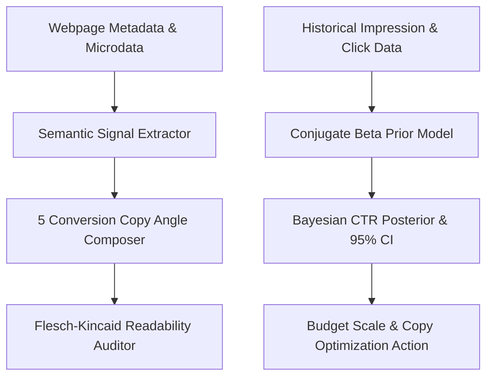

# genpark-url-to-ad


GenPark URL-To-Ad is a zero-dependency autonomous advertising copy and performance prediction engine implementing OpenGraph semantic parsing, multi-angle conversion framework generation (PAS, BAB, Social Proof, FOMO, Feature-Benefit), and Bayesian Beta-Binomial conjugate CTR estimation.



## Features
- **Semantic Metadata Signal Scorer**: Parses OpenGraph and schema attributes into structured product entities with readiness validation.
- **5-Angle Conversion Copywriting**: Formulates PAS, BAB, Authority, Scarcity, and Benefit angles with readability metrics.
- **Conjugate Bayesian CTR Estimator**: Computes calibrated click-through rate posteriors and 95% credible intervals with Beta distributions.

## Quickstart

```python
from client import GenParkUrlToAd

engine = GenParkUrlToAd()
res = engine.predict_bayesian_ctr_score(historical_impressions=10000, historical_clicks=250, ad_relevance_score=0.9)
print(res["calibrated_predicted_ctr_pct"], "% CTR")
```

## License
MIT
